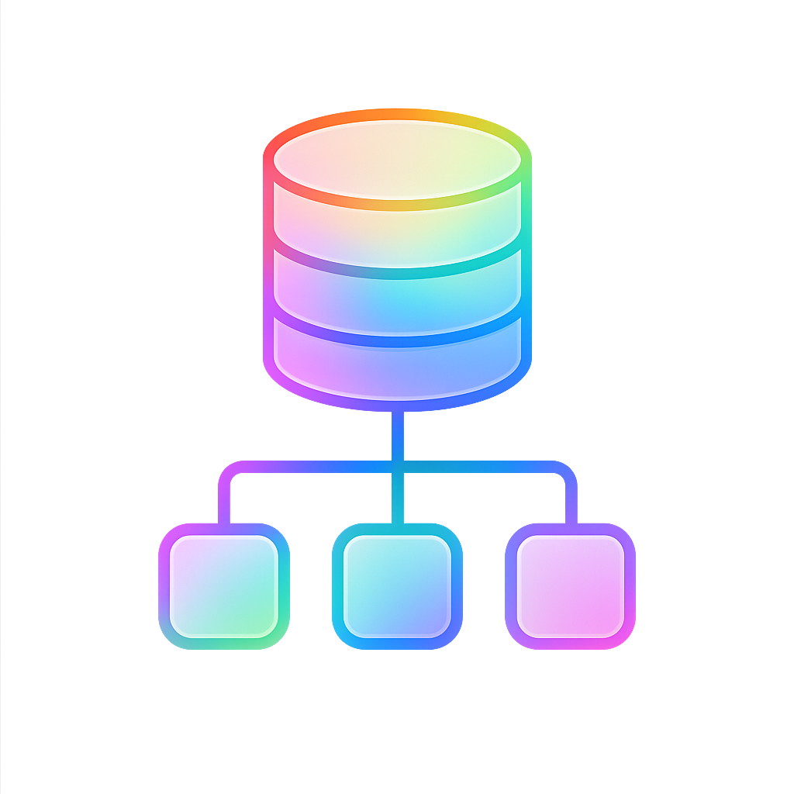

<div align="center">



# NormaFlow

**Turn raw CSV files into normalized database schemas — ERDs, SQL DDL and full normalization reports — in seconds.**

[](LICENSE)
[](https://github.com/miskatul-anwar/normaflow/releases)
[](https://github.com/miskatul-anwar/normaflow/actions/workflows/ci.yml)
[](CONTRIBUTING.md)
[](https://tauri.app)
[](https://react.dev)

*One desktop app for CSV → 1NF → 2NF → 3NF → ERD → SQL. Private by design — your data never leaves your machine.*

</div>

---

## What is NormaFlow?

NormaFlow is a **free & open-source cross-platform desktop app** that reverse-engineers relational databases from CSV exports.

Drop in one or many CSV files and NormaFlow will:

- 🧹 **Clean & validate** your data (atomicity checks, null handling, type profiling)
- ⛏️ **Mine functional dependencies** with a fast partition-refinement algorithm (TANE-inspired lattice pruning)
- 🔑 **Discover candidate keys** using attribute-closure search over the FD lattice
- 🧩 **Decompose to 3NF / BCNF** with lossless-join verification (chase, plus a re-join on your data) and dependency-preservation analysis
- 🕸️ **Detect cross-table foreign keys** from the data (inclusion dependencies scored by containment, coverage, name and type evidence)
- 🧠 **Classify columns semantically** (NLP profiler: names, e-mails, prices, dates, locations, organizations…)
- 📊 **Generate Mermaid ERDs**, consolidated SQL DDL, and a Markdown normalization report

## Highlights

| | |
|---|---|
| 🔒 **Private by design** | All processing happens locally. The only optional network use is a loopback call to a local Ollama for the natural-language box; CSV data is never sent. |
| ⚡ **One engine** | The same TypeScript analysis runs for one file or many, in the desktop app and in the browser. |
| 🧮 **Sound algorithms** | Functional-dependency mining, closure-based key discovery, 3NF synthesis. Only dependencies that hold on every row shape the schema. |
| 🖱️ **Visual pipelines** | Build workflows on an interactive React Flow canvas — click or drag the operations you want. |
| 📦 **Portable outputs** | Mermaid, `.sql`, `.md` and workflow `.json` files you can commit to your repo. |
| 🪶 **Lightweight** | Native binary, tiny footprint compared to Electron alternatives. |

## Installation

### Download (recommended)

Grab the latest installer for your platform from the [**Releases page**](https://github.com/miskatul-anwar/normaflow/releases):

| Platform | Artifact |
|---|---|
| Windows | `.msi` / `.exe` |
| macOS | `.dmg` / `.app` |
| Linux | `.deb` / `.rpm` / `.AppImage` |

> [!NOTE]
> macOS builds are unsigned. On first launch right-click → **Open**, or allow the app under *System Settings → Privacy & Security*.

### Build from source

Prerequisites: **Node.js ≥ 18**, **Rust ≥ 1.77**, and the [Tauri v2 system dependencies](https://tauri.app/start/prerequisites/).

```bash
git clone https://github.com/miskatul-anwar/normaflow.git
cd normaflow
npm install
npm run tauri dev    # development
npm run tauri build  # production bundle
```

<details>
<summary><b>Linux one-liner (Debian/Ubuntu)</b></summary>

```bash
sudo apt update && sudo apt install libwebkit2gtk-4.1-dev libappindicator3-dev librsvg2-dev patchelf
```
</details>

## Quick start

1. Launch NormaFlow and upload one or more CSV files (a sample dataset is preloaded).
2. Build your pipeline by clicking or dragging operations from the palette onto the canvas, or hit **Run All** for the full pipeline.
3. Run the pipeline.
4. Open the **Output** tab to browse the ERD, SQL DDL, FDs, keys, cardinalities and the full report — then download what you need.

## Natural-language box

Type a request such as *“Can you pls convert it to 1NF”* in the bar above the canvas (`Ctrl/Cmd+K` focuses it). NormaFlow shows the pipeline it would build, including the steps added because others need them, and you press **Apply** or **Apply & Run**. It works with keywords alone. For paraphrases the keywords miss, install [Ollama](https://ollama.com) and run:

```bash
ollama pull embeddinggemma-2:270m
```

The badge under the box shows whether embeddings are ready. Only your typed sentence is sent, and only to `localhost`. Accuracy numbers: [docs/EVALUATION.md](docs/EVALUATION.md).

## Command line

The same engine runs without the window:

```bash
npm run cli -- analyze data/orders.csv data/customers.csv --out out/ --dialect postgresql --json
```

Options: `--out`, `--dialect` (`postgresql`, `mysql`, `sqlite`, `ansi`), `--ops "FD Miner,3NF"`, `--max-lhs`, `--json`, `--verbose`.
`npm run bench` scores key, foreign-key and relation recovery on ground-truth schemas (see [docs/EVALUATION.md](docs/EVALUATION.md)).

## Architecture at a glance

```
┌──────────────────────────── WebView (frontend) ────────────────────────────┐
│  React 18 + TypeScript + Tailwind + React Flow                             │
│  ├─ Workflow canvas (nodes = pipeline operations)                          │
│  └─ Engine: CSV ingest · FD mining · keys · 2NF/3NF/BCNF · lossless and    │
│     preservation checks · foreign keys · ERD · SQL · report                │
└──────────────────────────────────┬─────────────────────────────────────────┘
                                   │ window only
┌──────────────────────────────────▼─────────────────────────────────────────┐
│  Rust shell (Tauri 2): native window, CSP                                  │
└────────────────────────────────────────────────────────────────────────────┘
```

Read the full story in [`docs/ARCHITECTURE.md`](docs/ARCHITECTURE.md).

## Project structure

```
normaflow/
├── src/                  # React frontend
│   ├── components/       # UI components (canvas nodes, panels, output views)
│   ├── hooks/            # Reusable state logic (workflow graph, execution)
│   ├── services/         # Engine services (FD mining, NLP profiler)
│   ├── config/           # Operation registry
│   └── utils/            # Pure helpers (validation, edge rules, result cache)
├── src-tauri/            # Rust shell (window, CSP)
├── docs/                 # Architecture & release docs
└── .github/              # CI, release automation, issue/PR templates
```

## Contributing

Contributions are welcome — code, docs, bug reports, feature ideas! See [`CONTRIBUTING.md`](CONTRIBUTING.md) to get started. Good first issues are labeled [`good first issue`](https://github.com/miskatul-anwar/normaflow/labels/good%20first%20issue).

Please read our [`Code of Conduct`](CODE_OF_CONDUCT.md) — be kind, be constructive.

## Security

Found a vulnerability? Please follow our [security policy](SECURITY.md) and report privately — do not open a public issue.

## License

[MIT](LICENSE) © Miskatul Anwar

---

<div align="center">

If NormaFlow saves you time, please consider giving the repo a ⭐ — it helps others discover the project!

[Report Bug](https://github.com/miskatul-anwar/normaflow/issues/new?template=bug_report.yml) · [Request Feature](https://github.com/miskatul-anwar/normaflow/issues/new?template=feature_request.yml)

</div>

